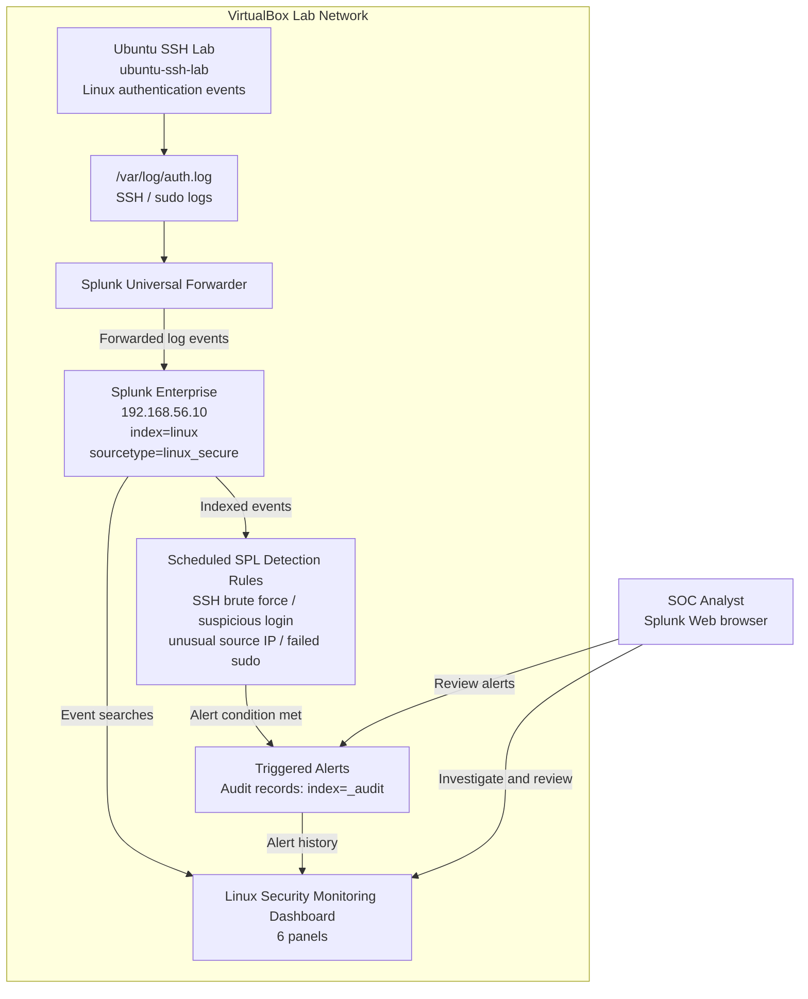

# Enterprise SOC Monitoring Lab — Architecture

This diagram documents the validated Linux SSH security monitoring workflow. The environment runs on Oracle VirtualBox and uses Splunk Enterprise and a Splunk Universal Forwarder.

## Validated scenario — 13 November 2026

- Six controlled failed SSH logins were generated against the Ubuntu lab host using the local loopback source address `127.0.0.1`.
- The SPL detection logic identified five and then six failed attempts in a rolling five-minute window.
- The scheduled search `SOC - SSH Brute Force Alert` ran successfully at 11:25 (Splunk-displayed time) with `result_count=2`.
- An `alert_fired` audit record appeared for that rule; the alert was visible on the dashboard together with the relevant SSH authentication events.

## Scope and limitations

- This is a controlled lab demonstration, not evidence of production deployment or 24/7 operation.
- The end-to-end test validates the SSH brute-force scenario; the other rules are documented separately.
- `127.0.0.1` is the source of the local test connections, not an external attacker.
- The diagram is a logical view; it does not assert an unverified ingestion port or network security control.
